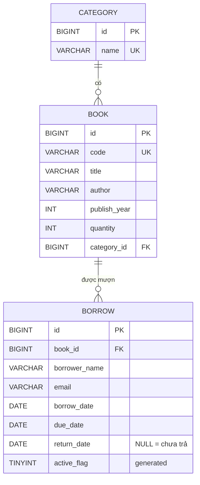
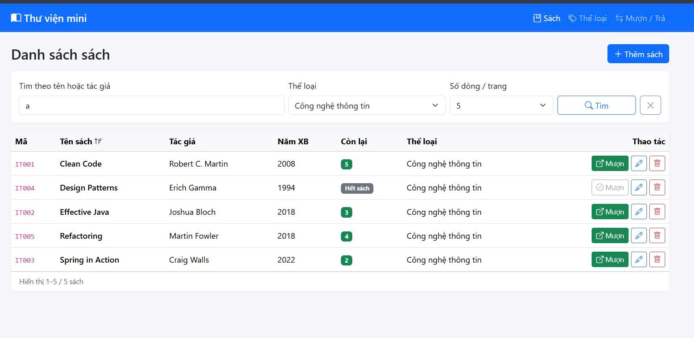
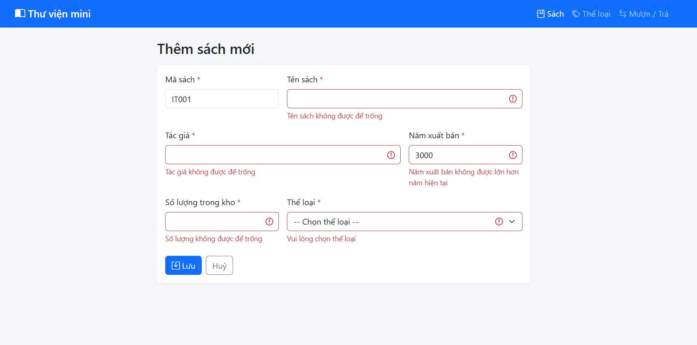
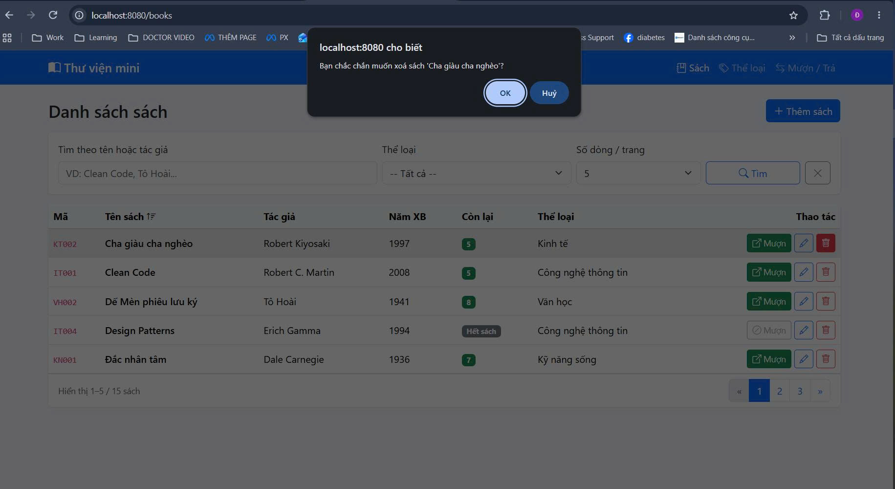
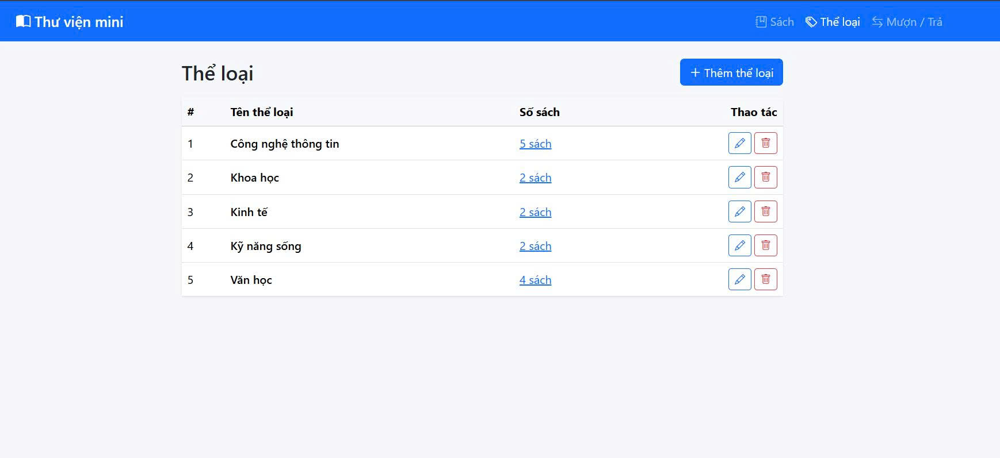
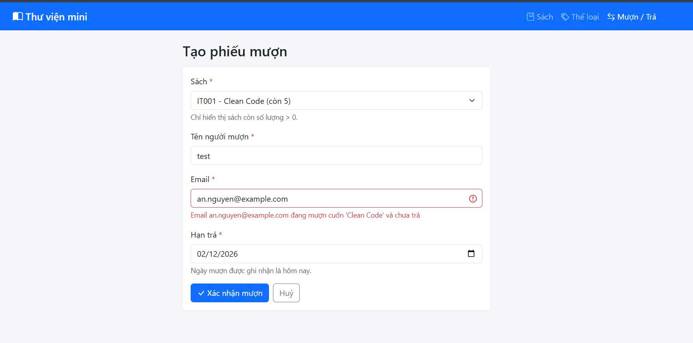
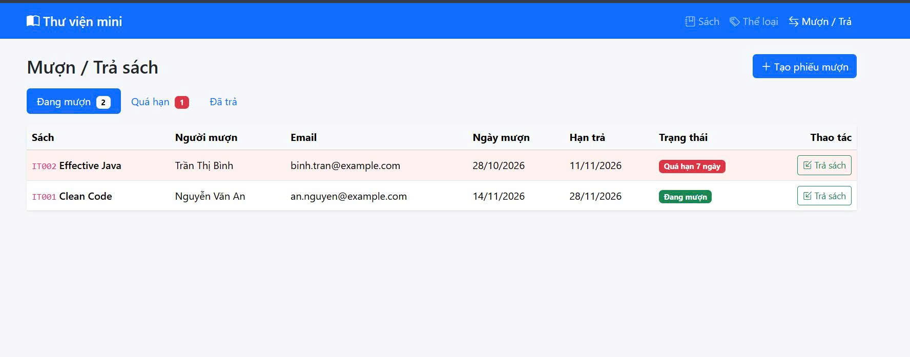
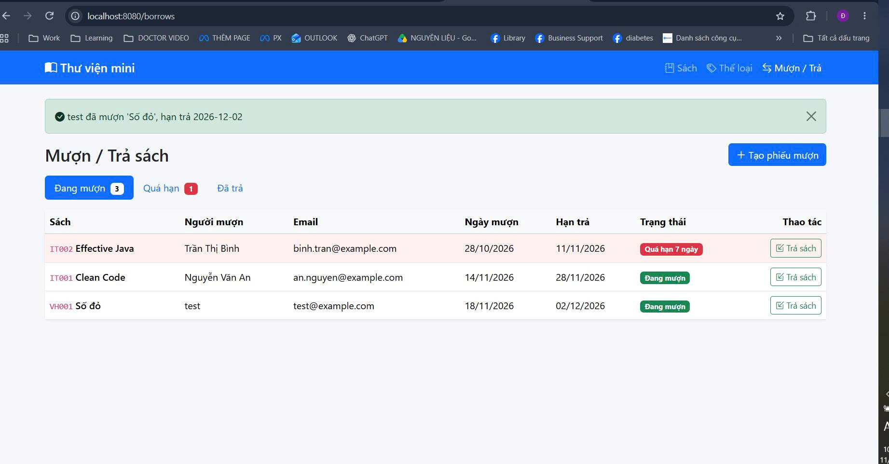
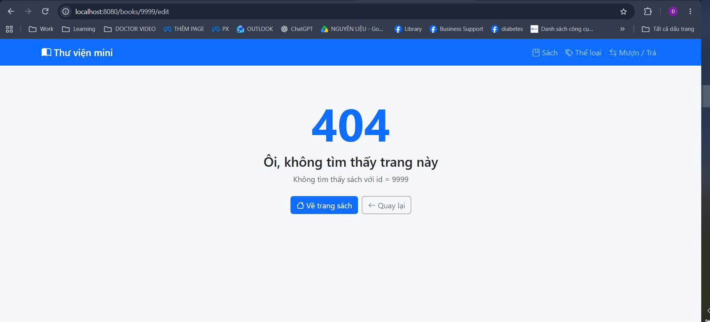

# 📚 Mini web quản lý thư viện

Ứng dụng web render phía server để quản lý sách, thể loại và lượt mượn/trả.

**Công nghệ:** Java 17 · Spring Boot 3.3 · Spring MVC + Thymeleaf · Spring Data JPA · MySQL 8 · Flyway · Bootstrap 5 · JUnit 5 + Mockito

---

## Mục lục
1. [Chức năng](#1-chức-năng)
2. [Cách chạy](#2-cách-chạy)
3. [Thiết kế cơ sở dữ liệu](#3-thiết-kế-cơ-sở-dữ-liệu)
4. [Cấu trúc code](#4-cấu-trúc-code)
5. [Unit test](#5-unit-test)
6. [Ảnh chụp màn hình](#6-ảnh-chụp-màn-hình)

---

## 1. Chức năng

| # | Yêu cầu | Cách làm |
|---|---------|----------|
| 1 | Danh sách sách: tìm theo tên/tác giả, lọc thể loại, phân trang, sắp xếp | `GET /books?q=&categoryId=&page=&size=&sort=&dir=` — một truy vấn JPQL có điều kiện tuỳ chọn, `Pageable` + `Sort`. Bấm tiêu đề cột để đảo chiều sắp xếp. Cột sắp xếp được kiểm tra theo whitelist |
| 2 | Form thêm/sửa sách & thể loại, validate, lỗi từng trường, xoá có xác nhận | Bean Validation trên DTO (`@NotBlank`, `@Size`, `@Pattern`, `@Min`, `@Email`, annotation tự viết `@NotFutureYear`). Lỗi nghiệp vụ (trùng mã sách, trùng tên thể loại) cũng được gắn vào đúng trường. Xoá bằng `POST` + hộp thoại xác nhận |
| 3 | Mượn sách: hết sách không cho mượn; một email không mượn trùng một cuốn khi chưa trả | Kiểm tra ở service **và** chặn ở DB: trừ kho bằng `UPDATE ... WHERE quantity > 0` (nguyên tử), unique key `uk_borrow_active` trên cột sinh tự động |
| 4 | Trả sách, trang danh sách đang mượn, đánh dấu quá hạn | `/borrows` có 3 tab *Đang mượn / Quá hạn / Đã trả*; dòng quá hạn tô đỏ kèm số ngày quá hạn |
| 5 | Trang 404 thân thiện, thông báo sau mỗi thao tác | `@ControllerAdvice` chuyển `ResourceNotFoundException`, URL không tồn tại, id sai kiểu → `error/404.html`. Flash message (thành công / lỗi) sau mỗi thao tác |
| 6 | ≥ 5 unit test tầng service | 18 test (JUnit 5 + Mockito), xem [mục 5](#5-unit-test) |

**Quy ước số lượng:** `book.quantity` là số cuốn **còn trong kho có thể cho mượn** — giảm 1 khi mượn, tăng 1 khi trả.

---

## 2. Cách chạy

### Yêu cầu
- JDK 17+
- Maven 3.9+ (hoặc mở bằng IntelliJ IDEA)
- MySQL 8.0.16+ (cần hỗ trợ `CHECK` constraint và generated column)

### Các bước

```bash
# 1. Clone
git clone https://github.com/<username>/library-management.git
cd library-management

# 2. Cấu hình MySQL (mặc định: localhost:3306, user root / mật khẩu root)
#    Database library_db được tạo tự động nhờ createDatabaseIfNotExist=true.
#    Muốn dùng tài khoản khác thì đặt biến môi trường:
export DB_USERNAME=root
export DB_PASSWORD=matkhau_cua_ban
# (Windows PowerShell: $env:DB_PASSWORD="matkhau_cua_ban")

# 3. Chạy ứng dụng — Flyway tự tạo bảng và nạp dữ liệu mẫu ở lần chạy đầu
mvn spring-boot:run

# 4. Mở trình duyệt
#    http://localhost:8080
```

Chạy test:

```bash
mvn test
```

Đóng gói jar:

```bash
mvn clean package
java -jar target/library-management-1.0.0.jar
```

---

## 3. Thiết kế cơ sở dữ liệu

Bảng được tạo bằng **Flyway migration** (Hibernate chỉ `validate`, không tự sinh bảng):

| File | Nội dung |
|------|----------|
| [`V1__create_tables.sql`](src/main/resources/db/migration/V1__create_tables.sql) | Tạo bảng, khoá, ràng buộc, index |
| [`V2__seed_data.sql`](src/main/resources/db/migration/V2__seed_data.sql) | 5 thể loại, 15 sách, 3 lượt mượn mẫu (1 đang mượn, 1 quá hạn, 1 đã trả) |

Nếu muốn tạo bảng thủ công, chạy trực tiếp `V1__create_tables.sql` trong MySQL (khi đó đặt `spring.flyway.enabled=false`).

### Sơ đồ quan hệ



### Các điểm thiết kế đáng chú ý

- **Ràng buộc ở DB, không chỉ ở code:** `UNIQUE(category.name)`, `UNIQUE(book.code)`, `CHECK(quantity >= 0)`, `CHECK(due_date >= borrow_date)`, khoá ngoại `RESTRICT` (không xoá được thể loại còn sách / sách đã có lịch sử mượn).
- **Chống mượn trùng ở mức DB:** cột sinh `active_flag = 1` khi `return_date IS NULL`, ngược lại `NULL`. Unique key `(book_id, email, active_flag)` chỉ chặn các lượt **chưa trả** vì MySQL cho phép nhiều giá trị `NULL` trong unique index → một người vẫn mượn lại được cuốn đó sau khi đã trả.
- **Trừ kho nguyên tử:**
  ```sql
  UPDATE book SET quantity = quantity - 1 WHERE id = ? AND quantity > 0
  ```
  Nếu số dòng bị ảnh hưởng = 0 → hết sách. Hai người mượn cùng lúc cuốn cuối cùng thì chỉ một người thành công.
- **Index** cho các truy vấn thường dùng: `book(title)`, `book(author)`, `book(category_id)`, `borrow(return_date, due_date)` cho trang đang mượn / quá hạn.
- **Không N+1:**
  - Danh sách sách dùng `@EntityGraph(attributePaths = "category")`.
  - Danh sách thể loại kèm số sách bằng **một** truy vấn:
    ```sql
    SELECT c.id, c.name, COUNT(b.id)
    FROM category c LEFT JOIN book b ON b.category_id = c.id
    GROUP BY c.id, c.name
    ```
- Email lưu chữ thường để so sánh trùng không phân biệt hoa thường; dữ liệu `utf8mb4` để lưu tiếng Việt.

---

## 4. Cấu trúc code

```
src/main/java/com/example/library
├── LibraryApplication.java
├── config/          TimeConfig – bean Clock (giúp test cố định ngày)
├── entity/          Category, Book, Borrow – entity có hành vi (rename, updateDetails,
│                    markReturned, isOverdue…), không phải chỉ getter/setter
├── repository/      Spring Data JPA + JPQL tuỳ biến
├── service/         Nghiệp vụ & transaction: CategoryService, BookService, BorrowService
│                    BookSearchCriteria (record chuẩn hoá tham số), BorrowStatus (enum)
├── dto/             BookForm, CategoryForm, BorrowForm (validate), CategoryView
├── validation/      @NotFutureYear + validator
├── exception/       ResourceNotFoundException (→404), BusinessException (lỗi nghiệp vụ, có thể gắn trường)
└── web/
    ├── controller/  BookController, CategoryController, BorrowController, HomeController
    ├── GlobalExceptionHandler.java
    ├── FormErrors.java   gắn BusinessException vào BindingResult
    └── UrlHelper.java    dựng link phân trang/sắp xếp giữ nguyên bộ lọc

src/main/resources
├── db/migration/    Flyway
├── templates/       fragments/layout.html (head, navbar, flash, pagination dùng chung)
│                    books/, categories/, borrows/, error/404.html, error.html
└── static/          css/app.css, js/app.js (xác nhận xoá)
```

Nguyên tắc chính:
- **Controller mỏng** — chỉ nhận request, gọi service, chọn view. Mọi quy tắc nghiệp vụ nằm ở service/entity.
- **Đóng gói** — entity không có setter công khai; trạng thái chỉ đổi qua phương thức có kiểm tra (`Borrow.markReturned()` báo lỗi nếu đã trả).
- **DTO tách khỏi entity** — form không bind thẳng vào entity, tránh mass-assignment.
- **PRG (Post/Redirect/Get)** sau mỗi thao tác ghi để F5 không gửi lại form.
- Inject phụ thuộc qua constructor; `Clock` được inject để test không phụ thuộc ngày thật.

---

## 5. Unit test

`src/test/java/com/example/library/service` — 18 test, chạy bằng `mvn test`, không cần database (mock repository bằng Mockito).

| Lớp test | Kịch bản |
|----------|----------|
| `BorrowServiceTest` (10) | mượn thành công · **hết sách không cho mượn** · **mượn trùng khi chưa trả** · race condition bị unique key chặn · hạn trả trong quá khứ · sách không tồn tại · trả sách thành công · trả lại lần 2 · trả lượt không tồn tại · xác định quá hạn |
| `BookServiceTest` (5) | thêm sách (chuẩn hoá mã) · trùng mã sách · sửa sách không tồn tại → 404 · không xoá sách đã có lịch sử mượn · chuẩn hoá tham số tìm kiếm/sắp xếp |
| `CategoryServiceTest` (3) | trùng tên thể loại · sửa thể loại · không xoá thể loại còn sách |

---

## 6. Ảnh chụp màn hình

> Ảnh nằm trong thư mục [`docs/screenshots`](docs/screenshots).

| Trang | Ảnh |
|-------|-----|
| Danh sách sách (tìm kiếm, lọc, phân trang, sắp xếp) |  |
| Form thêm sách – hiển thị lỗi từng trường |  |
| Xác nhận xoá |  |
| Danh sách thể loại |  |
| Form mượn sách – lỗi mượn trùng |  |
| Danh sách đang mượn – đánh dấu quá hạn |  |
| Thông báo thành công sau thao tác |  |
| Trang 404 |  |
